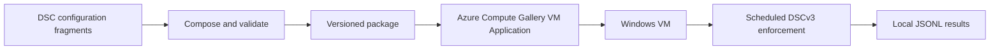

# DSC Orchestrator

Package and deliver DSCv3 configurations, then enforce them on a schedule across Windows VMs.

## Why

DSCv3 is a capable configuration engine, but it does not orchestrate configuration across a fleet. DSC Orchestrator fills that gap by composing, packaging, delivering, and scheduling DSCv3 enforcement. Its design builds on an orchestrator running in production across 10,000+ Windows VMs.

## What it does

- **Compose** configuration fragments and validate them against the DSCv3 schema.
- **Package** configurations, declared resource modules, and pinned runtimes into versioned ZIP files.
- **Deliver** packages as Azure Compute Gallery VM Applications.
- **Enforce** desired state on a schedule with a Windows agent.
- **Report drift** and resource results to local JSONL files, and optionally to Log Analytics with a Grafana dashboard.



## Quick start

**Try it locally (no Azure):** Step 1 builds the sample package on your machine; you can stop there without an Azure subscription.

### Prerequisites

| Where | What you need |
| --- | --- |
| Build machine | PowerShell 7 (`pwsh`), `powershell-yaml` 0.4.12, and HTTPS access to PSGallery and GitHub release downloads. |
| Azure | A selected subscription and Az PowerShell modules. Use [Create the Azure resources](docs/quickstart.md#step-3-create-the-azure-resources) to set up the Compute Gallery, storage account, and package container. |
| Target VM | x64 Windows Server 2019 or later, or Windows 11, a healthy Azure VM Agent, and `tar.exe`. |

Install the build dependency in PowerShell 7 (CI and release builds use version 0.4.12):

```powershell
Install-Module -Name powershell-yaml -RequiredVersion 0.4.12 -Scope CurrentUser -Repository PSGallery -Force
```

1. **Build the sample package locally.**

   ```powershell
   $packageOutput = Join-Path $env:TEMP ('dsc-orchestrator-quickstart-' + [guid]::NewGuid().ToString('N'))
   $package = .\build\New-DscOrchestratorPackage.ps1 -ConfigPath .\examples\basic\dsc-orchestrator.config.json -OutputPath $packageOutput
   $package | Format-List Name, Version, PackagePath
   ```

   You should see `Name: basic-sample`, `Version: 1.0.0`, and a package path ending in `dsc-orchestrator-basic-sample-1.0.0.zip`.

To publish, deploy, and verify on a VM, follow the [quickstart](docs/quickstart.md).

## How it works

The composer renders and validates DSC YAML fragments, the package builder adds declared modules and pinned DSC and PowerShell runtimes, and the Windows agent installs the package and runs enforcement on a schedule. The Azure VM Application adapter delivers each versioned ZIP. See the [architecture overview](docs/architecture/overview.md) for component boundaries and contracts.

## Configuration

The checked-in [basic configuration](examples/basic/dsc-orchestrator.config.json) is:

```json
{
  "schemaVersion": "1.0",
  "name": "basic-sample",
  "version": "1.0.0",
  "group": "basic-example",
  "role": "sample-host",
  "fragments": [
    {
      "name": "baseline",
      "path": "fragments/baseline.dsc.yaml"
    }
  ]
}
```

`schemaVersion` selects the input contract; `name` and `version` identify the package. `group` and `role` are optional metadata included in results. `fragments` lists the DSC YAML files to compose. See the [configuration schema](src/core/contracts/dsc-orchestrator-config.schema.json) for the full contract.

## Documentation

| Guide | Covers |
| --- | --- |
| [Quickstart](docs/quickstart.md) | Build, publish, deploy, verify, and clean up the sample. |
| [Architecture](docs/architecture/overview.md) | Components, package contracts, and reporting boundaries. |
| [Package format](docs/package-format/README.md) | Authoring input and the produced ZIP layout. |
| [Operations](docs/operations/README.md) | VM verification, local logs, and reboot handling. |
| [Reporting](src/adapters/reporting/README.md) | Optional Log Analytics reporting and Grafana dashboard. |
| [Release pipeline](pipelines/README.md) | Azure Pipelines release example and permissions. |
| [Contributing](CONTRIBUTING.md) | Local checks and contribution guidance. |

## Roadmap and status

Version 1 targets Windows VMs and Azure Compute Gallery VM Applications. Results are always written to local JSONL, with optional Log Analytics reporting. Linux support is not part of v1.

## Contributing

This project welcomes contributions and suggestions.  Most contributions require you to agree to a
Contributor License Agreement (CLA) declaring that you have the right to, and actually do, grant us
the rights to use your contribution. For details, visit [Contributor License Agreements](https://cla.opensource.microsoft.com).

When you submit a pull request, a CLA bot will automatically determine whether you need to provide
a CLA and decorate the PR appropriately (e.g., status check, comment). Simply follow the instructions
provided by the bot. You will only need to do this once across all repos using our CLA.

This project has adopted the [Microsoft Open Source Code of Conduct](https://opensource.microsoft.com/codeofconduct/).
For more information see the [Code of Conduct FAQ](https://opensource.microsoft.com/codeofconduct/faq/) or
contact [opencode@microsoft.com](mailto:opencode@microsoft.com) with any additional questions or comments.

See [CONTRIBUTING.md](CONTRIBUTING.md) for how to run the checks locally.

## Security

Report suspected vulnerabilities privately to the [Microsoft Security Response Center (MSRC)](https://aka.ms/msrc); do not report them in public issues or pull requests. See [SECURITY.md](SECURITY.md).

## Third-party components

The package builder downloads and bundles the pinned DSC CLI and PowerShell 7 versions listed in [THIRD-PARTY-NOTICES.md](THIRD-PARTY-NOTICES.md). It also bundles the PowerShell resource modules you declare; those stay under their own licenses, and you're responsible for confirming you can redistribute them.

## License

Licensed under the [MIT License](LICENSE).

## Trademarks

This project may contain trademarks or logos for projects, products, or services. Authorized use of Microsoft
trademarks or logos is subject to and must follow
[Microsoft's Trademark & Brand Guidelines](https://www.microsoft.com/legal/intellectualproperty/trademarks/usage/general).
Use of Microsoft trademarks or logos in modified versions of this project must not cause confusion or imply Microsoft sponsorship.
Any use of third-party trademarks or logos are subject to those third-party's policies.
